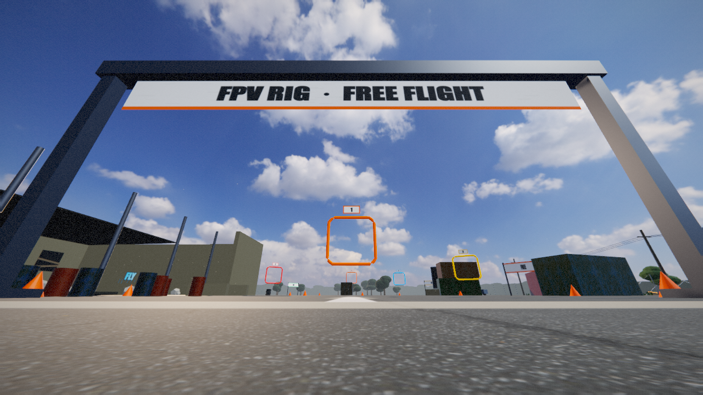
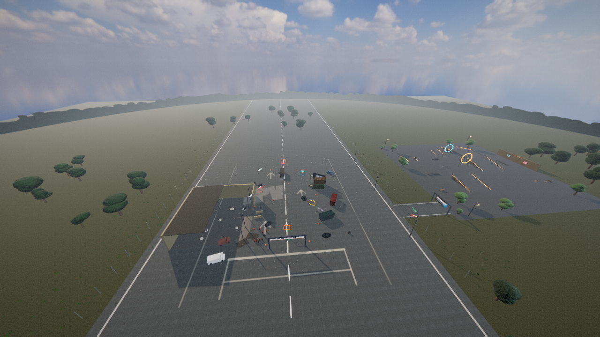
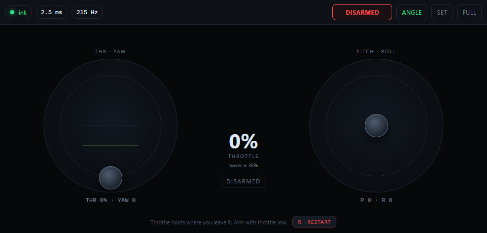

# FPV Rig

**A zero-cost, offline FPV simulator that turns an Android phone into a real transmitter over USB.**

The laptop runs the physics and renders the airfield. The phone is the radio: absolute
throttle that stays where you put it, an arm switch, expo, and a link that targets 250 Hz
down a USB cable. No accounts, no internet, no APK, no virtual gamepad.

<p align="center">
  
</p>

## What it is

FPV Rig is a local flight simulator built around one idea: **a phone can be a better
transmitter than a gamepad if it stops behaving like a gamepad.** It streams the raw
positions of two gimbals to a desktop-class flight model, which applies the same semantics
a radio does — throttle hold, arm state, expo, deadband and failsafe.

The result is a cheap way to practise real FPV habits: hover at a fixed throttle, manage
altitude with small inputs, fly a gate line, and recover from mistakes. It is not a
replacement for a full commercial sim, and it is not connected to a real aircraft.

## Design goals

- **Real transmitter semantics.** Throttle is a position, not a spring. The arm switch
  gates the motors. Expo and deadband live on the phone, where a radio would apply them.
- **A flight model that behaves like a 5-inch quad.** Fixed 1 kHz rigid-body physics,
  thrust that scales with throttle squared, motor lag, rate PID, prop wash and battery sag.
- **Local and free.** Only a laptop, a phone and a USB cable are required. The server binds
  to loopback; nothing is exposed to the network and nothing needs an account.
- **Smooth and measurable.** Rendering and physics are decoupled. The HUD reports link
  rate, round-trip time, physics tick rate and frame time so the pipeline is visible.
- **Honest failure.** Small knocks are survivable; a real slam ends the run. There is no
  automatic respawn, so a mistake has a cost.

**Non-goals:** controlling a real aircraft, multiplayer, cloud hosting, a native mobile
app, and photoreal asset production. A virtual-gamepad bridge for third-party sims is
possible but is not part of the current build.

## Highlights

- **Phone as TX over USB** — the page is served from the phone's own `127.0.0.1` through
  `adb reverse`; the link never touches Wi-Fi or a router.
- **Absolute throttle, Mode 1/2, hold/spring** — the default is Mode 2 with HOLD. A training
  mode springs the throttle back to the hover point.
- **ANGLE and ACRO** — ANGLE is the phone default and self-levels to ±45°; ACRO exposes the
  full freestyle rate model. The top-right button switches between them.
- **1 kHz physics** — quaternion rigid body, gyroscopic coupling, linear + quadratic drag,
  motor lag, differential-thrust torque, yaw reaction, battery sag and prop-wash disturbance.
- **Forgiving contact model** — light bumps bounce and slide; only hard impacts or a
  nearly-inverted ground strike end the attempt.
- **A real course** — 100 m × 400 m runway, warehouse, containers, tyres, pallets and five
  gates, with FPV, chase and overview cameras.
- **Instrumented** — live HUD for RTT, packet rate, physics Hz, FPS, frame time, voltage,
  altitude, speed, tilt and run timer.

## How it works

```
┌──────────────────────────────┐          USB cable / adb reverse          ┌────────────────────────────────┐
│ Android phone                │                                           │ Laptop                         │
│ Chrome, /tx/                 │  ws://127.0.0.1:8080/ws   ~1 ms loopback  │ Node server                    │
│  · two gimbals, Mode 1/2     │ ────────────────────────────────────────► │  · static files                │
│  · absolute throttle         │                                           │  · WebSocket relay             │
│  · arm, expo, deadband       │ ◄──────────────────────────────────────── │  · frame validation            │
│  · 250 Hz binary frames      │            status / telemetry             │                                │
└──────────────────────────────┘                                           │  ┌──────────────────────────┐  │
                                                                           │  │ three.js / WebGL2 sim    │  │
                                                                           │  │ 1 kHz flight physics     │  │
                                                                           │  │ HUD + cameras            │  │
                                                                           │  └──────────────────────────┘  │
                                                                           └────────────────────────────────┘
```

`adb reverse tcp:8080 tcp:8080` makes the phone's `127.0.0.1:8080` reach the laptop's
server. The phone loads the transmitter page from that address, opens a WebSocket back to
the same origin, and streams 22-byte binary frames. The relay validates each frame and
forwards it to every connected sim. The sim's input layer consumes the latest frame,
applies the TX conventions, and feeds the fixed-step physics.

The server binds to loopback only (`127.0.0.1:8080`), serves the static app and exposes
`/health`. A watchdog marks the link stale after 250 ms; stale input cuts the motors and
shows `LINK LOST` on the HUD.

## Quick start

### Requirements

- Windows 10 or 11 (the launcher and ADB helper are BAT/PowerShell scripts).
- Node.js 22 or newer.
- Chrome or Edge on the laptop.
- An Android phone with Developer options and USB debugging, plus a data-capable USB cable.

The Node server and web app themselves are platform-neutral; the convenience scripts are
Windows-specific.

### Run it

1. **Start the laptop side.** Double-click **`run.bat`**. On first run it installs
   dependencies, builds the app, starts the server and opens
   <http://127.0.0.1:8080/sim/>.
2. **Prepare the phone.** Enable **Developer options → USB debugging**, connect the cable
   and accept the RSA prompt.
3. **Open the cable tunnel.** Double-click **`connect-phone.bat`**. It uses the bundled
   `tools/platform-tools/adb.exe` and runs `adb reverse tcp:8080 tcp:8080`.
4. **Open the transmitter.** On the phone, open Chrome at
   **`http://127.0.0.1:8080/tx/`** and tap **FULL**.
5. **Arm and fly.** Pull the throttle to the bottom, tap **DISARMED → ARMED**, raise the
   throttle to about 36% and fly. In ANGLE, pushing the right stick forward pitches the
   nose down and moves you forward.
6. **Restart a run.** Use the **R** button next to **ARM** on the phone or `R` on the
   keyboard. A restart disarms the phone so the next run cannot start hot.

No phone nearby? The keyboard flies the same physics:

```text
W / S        throttle up / down (ramps, not a latch)
A / D        yaw
Arrow keys   pitch / roll
Space        arm / disarm
R            restart from the start line
C / O        chase / overview camera
[ / ]        camera tilt
V            analog look
M            mute audio
H            hide the help bar
```

The keyboard fallback runs ACRO; ANGLE is selected on the phone's top-right toggle.

## Controls

| Action | Phone transmitter | Keyboard |
|---|---|---|
| Arm / disarm | **ARM** button; throttle must be below 10% | `Space` |
| Throttle | left stick vertical, holds position | `W` / `S` |
| Yaw | left stick horizontal | `A` / `D` |
| Pitch / roll | right stick | arrow keys |
| ANGLE ↔ ACRO | top-right mode button | keyboard is ACRO |
| Restart | **R** next to **ARM** | `R` |
| Camera | — | `C` (chase), `O` (overview) |
| Camera tilt | — | `[` / `]` |
| Analog look | — | `V` |
| Mute | — | `M` |
| Hide help | — | `H` |
| TX settings | **SET** | — |

The phone's **SET** sheet exposes stick mode (1 or 2), throttle behavior (HOLD or SPRING),
expo, deadband, stick size, haptics, and pitch/yaw inversion. Settings are persisted in
`localStorage`. The page requests fullscreen and a screen wake lock; hiding the page
disarms the transmitter and releases the sticks.

## Specifications

### Airframe and flight model

| Property | Value |
|---|---|
| All-up mass | 650 g |
| Class | 5-inch, 115 mm motor-to-centre arms, 6S |
| Motors | 4 × 12.5 N maximum thrust (50 N total) |
| Thrust-to-weight | 7.8 : 1 |
| Hover throttle | ≈ 36% at a full pack |
| Thrust curve | proportional to throttle², with first-order motor lag (τ = 20 ms) |
| Rate limits (ACRO) | 800 °/s pitch, 500 °/s yaw, 800 °/s roll |
| ANGLE mode | ±45° lean, 250 °/s yaw cap, ≈ 0.2 s step response |
| Drag | linear 0.05, quadratic 0.012 |
| Battery | 25.2 V full pack, 2.4 V sag at full load |
| Disturbances | prop wash while descending, angular damping, gyroscopic coupling |
| Integration | fixed 1 kHz accumulator, quaternion orientation |

The flight model is a renderer-independent TypeScript module
(`apps/sim/src/physics.ts`). It has no three.js imports and is exercised directly by the
unit tests.

### Flight controller

- Betaflight-style rate loop: proportional, integral and derivative terms on body rates,
  with integral clamping and a filtered derivative.
- Per-axis rate limits, with a lower yaw cap in ANGLE so attitude correction cannot be
  outrun by yaw.
- ANGLE mode uses a heading-relative lean target, a 50 ms target filter, `kp = 4` and a
  260 °/s correction limit. The result is predictable, but quick enough to feel connected.
- Arming is gated by the phone (throttle below 10%). Link loss and page hide both disarm.
- A hard crash cuts the motors and leaves the quad where it fell; `R` resets to the start.

### Link and protocol

The phone sends a **22-byte little-endian frame** at a 250 Hz target (the browser timer
limits are typically 140–250 Hz):

| Offset | Type | Field |
|---:|---|---|
| 0 | `u8` | magic `0xF1` |
| 1 | `u8` | message type (`1` = TX frame) |
| 2 | `u16` | sequence |
| 4 | `u32` | sender timestamp, microseconds |
| 8 | `i16` | throttle, `-1000` bottom … `+1000` top |
| 10 | `i16` | yaw, `-1000` left … `+1000` right |
| 12 | `i16` | pitch, `-1000` nose down … `+1000` nose up |
| 14 | `i16` | roll, `-1000` left … `+1000` right |
| 16 | `u8` | flags: bit 0 armed, bit 1 ANGLE, bit 2 HOLD, bit 3 failsafe, bit 4 reset pulse |
| 17 | `u8` | stick mode (1 or 2) |
| 18 | `u16` | auxiliary switches, reserved |
| 20 | `u16` | checksum of bytes 0–19 |

Malformed frames are dropped by the relay. The latest valid frame is cached and sent to a
newly connected sim immediately. JSON control messages carry `ping`/`pong`, `hello` and the
phone's `reset` request.

### Rendering

- three.js r186 on WebGL2; HDR sky, PBR ground and structure textures.
- Directional sun with shadows, 4× MSAA, a bloom pass, ACES-style grading, motion smear and
  a toggleable analog look.
- Adaptive render scale based on viewport size, plus runtime quality reduction when frame
  time slips.
- FPV camera at the body centre with adjustable tilt and speed-dependent FOV; springy chase
  camera; free overview camera.
- Fully local assets. The large HDR sky and texture set are committed so the sim works
  offline after a build.

## The course

The airfield is a 100 m × 400 m runway with a partly collapsed warehouse, stacked shipping
containers, tyre walls, pallets, barrels, light poles and five numbered gates. The start
gate is directly ahead of the spawn; gates 1–5 lead down the strip and around the props.



The phone transmitter:



## Measured performance

Numbers from the development machine (Windows, Chrome, USB-tethered Android phone):

| Metric | Result |
|---|---|
| Relay throughput, simulated TX | 250 frames/s |
| Phone ↔ server round trip over loopback | ≈ 1 ms |
| Physics tick rate | 1,000–1,100 Hz |
| Phone page send rate | 140–250 Hz (browser timer limits) |
| Render loop | GPU-bound; live frame time is shown in the HUD |
| Unit tests | 24 |

The physics tick is independent of render frame rate: a slow frame does not slow the
flight model, and the HUD exposes both rates so the claim is checkable.

## Project layout

```text
fpv/
├─ apps/
│  ├─ server/              Node static host + WebSocket relay + /health
│  │  ├─ src/server.ts
│  │  └─ public/           sim, tx, textures, HDR, HUD
│  ├─ sim/                 three.js client and physics
│  │  └─ src/
│  │     ├─ physics.ts     rigid body, motors, rate loop, crash model
│  │     ├─ input.ts       phone link, reset handling, keyboard fallback
│  │     ├─ scene.ts       airfield, props, gates, colliders
│  │     ├─ post.ts        HDR pipeline, bloom, grading, analog look
│  │     ├─ quad.ts        quad model and rotor visuals
│  │     ├─ assets.ts      texture/HDR loading
│  │     └─ main.ts        render loop, cameras, HUD, audio
│  └─ tx/                  phone transmitter page
├─ packages/protocol/      22-byte frame codec, shared by all three apps
├─ tests/                  physics + protocol unit tests
├─ tools/                  ADB tunnel, smoke, touch, screenshot and perf checks
├─ docs/                   architecture, roadmap and media
├─ run.bat                 install, build, serve, open the sim
└─ connect-phone.bat       set up adb reverse
```

## Development

```bat
npm install
npm run build       :: dist/server.js + public sim.js/tx.js
npm start           :: serve on http://127.0.0.1:8080
npm run watch       :: rebuild on change
npm run typecheck   :: TypeScript, no emit
```

Build outputs (`dist/`, `apps/server/public/sim/sim.js`,
`apps/server/public/tx/tx.js`) are intentionally not committed. Run `npm run build` after a
fresh clone, or use `run.bat`, which does it for you.

The server binds to `127.0.0.1:8080`. The sim accepts `?alt=` (spawn altitude) and
`?view=chase|overview` for screenshots and testing.

## Testing

```bat
npm test                    :: 24 physics + protocol tests
npm run typecheck           :: strict TypeScript check
node tools/smoke.ts         :: server up, pages served, 250 Hz relay, phone reset
node tools/tx-test.mjs      :: touch drag, throttle hold, arm guard (server must run)
node tools/screenshot.mjs   :: headless render check + screenshots
node tools/perf.mjs         :: frame-time sampling helper
```

The physics suite covers hover equilibrium, the thrust curve, rate limits, ANGLE step
response, drag, crash forgiveness, dead-fall behavior and the 10 m/20 m drop cases. The
protocol suite covers round-trip encoding, checksum rejection and axis conversion.

## Status and roadmap

| Phase | Scope | Status |
|---|---|---|
| 0 | Skeleton, static server, USB tunnel, latency HUD | Done |
| 1 | Phone transmitter, throttle hold, arm, failsafe, settings | Done |
| 2 | Flight model, airfield, cameras, crash/reset | Done |
| 3 | Feel tuning against a real pilot; air mode; tuning panel | In progress |
| 4 | Gate timing, splits, laps, ghost | Planned |
| 5 | Visual and performance polish, OSD refinements | In progress |
| 6 | Optional ViGEm bridge for third-party sims | Exploratory |

Current limitations, stated plainly: **air mode / idle-up is not implemented**; there is no
lap timer or ghost yet; the in-sim rates/PID/camera panel is not built; the convenience
scripts target Windows. The flight model, ANGLE/ACRO modes, crash model and phone link are
working and tested. See [`docs/ROADMAP.md`](docs/ROADMAP.md) for the next steps and
[`docs/ARCHITECTURE.md`](docs/ARCHITECTURE.md) for the implementation details.

## Credits

- [three.js](https://threejs.org/) — MIT.
- [ws](https://github.com/websockets/ws) — MIT.
- [esbuild](https://esbuild.github.io/) — MIT.
- [TypeScript](https://www.typescriptlang.org/) — Apache-2.0.
- Sky and PBR textures from [Poly Haven](https://polyhaven.com/) — CC0.
- The rate-loop structure is inspired by Betaflight; this project is not affiliated with
  or endorsed by the Betaflight project.

## License

The source code is released under the MIT License — see [`LICENSE`](LICENSE). The bundled
Poly Haven sky and textures are CC0 and remain under their original terms.
