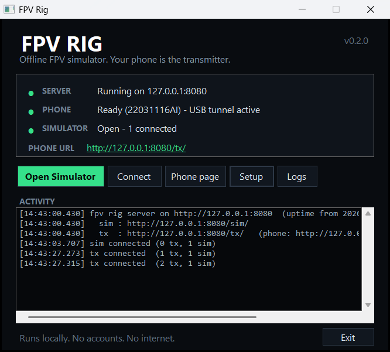

# Windows desktop build

<p align="center">
  
</p>

FPV Rig ships two Windows forms:

- **`FPV-Rig-0.3.0-Setup.exe`** — one-click, per-user installer. No administrator prompt.
- **`FPV-Rig-0.3.0-portable.zip`** — extract anywhere and run `FPV.exe`.

Both contain the simulator, the local Node server, the phone transmitter page, the ADB
helper and a small native launcher. Node.js and `adb` do **not** need to be installed on the
machine.

## What the launcher does

On launch it:

1. finds a free local port (starting at `8080`),
2. starts the bundled server with `HOST=127.0.0.1`,
3. opens the simulator in Chrome or Edge app mode,
4. checks for an Android phone through the bundled `adb`,
5. runs `adb reverse tcp:<port> tcp:<port>`,
6. opens `http://127.0.0.1:<port>/tx/` on the phone, and
7. shows server, phone, tunnel and simulator status in one window.

Closing the window keeps the launcher in the system tray. Use **Exit** in the tray menu or
the window to stop the server and quit.

The launcher binds the server to loopback only. No account, cloud service, router or
internet connection is involved.

## Install

1. Run **`FPV-Rig-0.3.0-Setup.exe`**.
2. Keep the desktop shortcut and **Open FPV Rig** checked, then click **Install FPV Rig**.
3. On the phone:
   - open **Settings → About phone** and tap **Build number** seven times,
   - open **Developer options** and enable **USB debugging**,
   - connect a **data-capable** USB cable,
   - tap **Allow** on the RSA prompt.
4. Wait for **PHONE** to turn green. The transmitter page opens on the phone.
5. Tap **FULL** on the phone, pull the throttle to the bottom, and arm.

The installer writes to:

```text
%LOCALAPPDATA%\Programs\FPV Rig     program files
%LOCALAPPDATA%\FPV                  settings, logs, browser profile
```

It creates Start Menu shortcuts, a desktop shortcut, an **Apps & features** entry and an
uninstaller. It does not request administrator rights.

### Silent install

For classroom imaging:

```bat
FPV-Rig-0.3.0-Setup.exe /silent
```

Silent install uses the same per-user folder and creates shortcuts, but does not launch the
sim. It returns exit code `0` on success and `1` on failure. Errors are written to
`%TEMP%\FPV-install-error.txt`.

### Uninstall

Use **Settings → Apps → Installed apps → FPV Rig → Uninstall**, or the **Uninstall FPV Rig**
Start Menu shortcut. The uninstaller keeps settings and logs by default; tick the checkbox
to remove them as well.

## Portable build

1. Extract `FPV-Rig-0.3.0-portable.zip`.
2. Run `FPV.exe` from the extracted `FPV-Rig-0.3.0` folder.
3. Settings and logs live in `data\` beside `FPV.exe`.

The portable build is useful for a USB stick, a lab machine without an installer policy, or
testing a new version beside an installed copy.

## First-run setup

The first launch explains how to enable USB debugging. It is shown once; later it is
available under **Setup**. **Copy diagnostics** collects the paths, health snapshot and
`adb devices -l` output for support.

The launcher cannot enable USB debugging or accept the RSA prompt by itself. Those are
Android security boundaries. "One click" means one click **after** the phone has been
prepared once.

## Troubleshooting

| Symptom | What to check |
|---|---|
| `adb.exe missing from the package` | Reinstall; the `tools\adb` folder is incomplete. |
| `No phone detected` | Try another cable. Many USB cables are charge-only. Use a USB data port, not a hub if possible. |
| `Phone detected - tap Allow` | Unlock the phone and accept the RSA prompt. If it never appears, revoke USB debugging authorisations in Developer options and reconnect. |
| `Phone is offline` | Unplug, replug, and accept the prompt again. On some OEM phones, set the USB mode to **File transfer / MTP**. |
| Phone still not found | Install the OEM USB driver, or use the phone's own USB tethering/driver package. On locked-down school PCs, the USB driver or ADB may be blocked by policy. |
| Sim opens in the default browser | Chrome or Edge is not installed. Install one for app mode, or use the browser tab. |
| `The local server did not become ready` | Open **Logs** and read `launcher.log` and `server.log`. Check that antivirus did not quarantine `node.exe`. |
| Port already in use | The launcher automatically tries the next port from `8080` upward. The phone URL in the window shows the chosen port. |
| SmartScreen warning | The build is unsigned. Choose **More info → Run anyway**. Code signing is a release step, not a functional requirement. |
| Phone page opens but no input | Make sure the phone page is at `127.0.0.1` (not a LAN IP), the cable is connected, and the launcher shows a green PHONE dot. |
| Audio is silent | Browsers require a click before audio. Click a map card or the volume control in the menu. |

## Build the Windows packages

From the repository root, on Windows:

```bat
npm install
npm run package:win
```

The build needs Node.js 22+ and the .NET Framework 4.x compiler that ships with Windows. If
`tools/platform-tools/adb.exe` is missing, `npm run package:win` downloads the official
Android platform-tools ZIP from Google and extracts it. Build artifacts are not committed.

It produces:

```text
dist/release/FPV-Rig-0.3.0/
dist/release/FPV-Rig-0.3.0-portable.zip
dist/release/FPV-Rig-0.3.0-Setup.exe
dist/release/SHA256SUMS.txt
```

The staged folder is the same layout used by both packages. The installer embeds a ZIP
payload and is self-contained. Build artifacts are not committed.

To run the launcher against the development tree:

```bat
npm run launcher
```

This builds the sim and server, compiles `dist/launcher/FPV.exe`, and starts it. The
development layout uses the Node runtime already on `PATH`.

## Release checklist

- [ ] `npm test`
- [ ] `npm run typecheck`
- [ ] `node tools/smoke.ts`
- [ ] `npm run package:win`
- [ ] Install from the Setup exe on a clean Windows account
- [ ] Connect a physical Android phone, accept the RSA prompt, fly a run
- [ ] Uninstall and confirm the folder, shortcuts and registry entry are gone
- [ ] Verify both artifacts against `SHA256SUMS.txt`
- [ ] Scan both artifacts with the organisation's antivirus
- [ ] Sign the Setup exe and `FPV.exe` if a code-signing certificate is available
- [ ] Upload the Setup exe and portable ZIP to the GitHub release

## Known limits

- Windows 10/11 only. The server and browser app remain portable to other desktops, but the
  launcher and installer are native Windows code.
- The installer is unsigned. SmartScreen reputation has to be earned or bought.
- No auto-update. Distribute a new Setup exe; it installs over the old version.
- No silent USB debugging enrolment. The phone must be prepared once.
- The launcher does not install OEM USB drivers. Android devices with unusual drivers may
  need a one-time driver install.
- The browser app-mode profile is dedicated to FPV Rig, so it will not inherit the user's
  normal Chrome extensions or bookmarks.
- The launcher picks a free port per session. If a firewall blocks loopback, the server and
  browser cannot talk.
